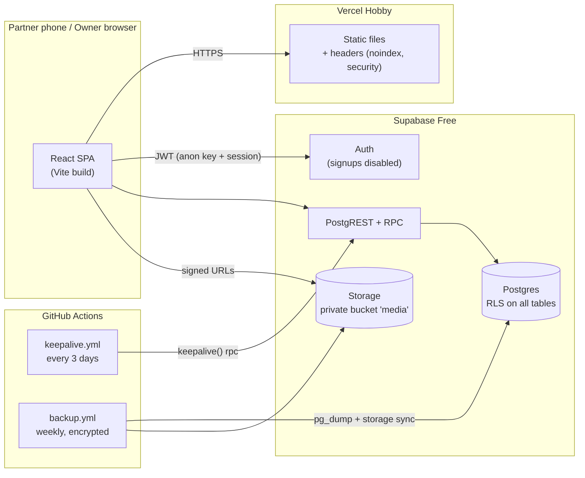

# Architecture — Our Little Universe

| Field | Value |
|---|---|
| Status | **APPROVED by owner (DESIGN)** |
| Version | 0.1 |
| Related | [DATABASE-DESIGN](../database/DATABASE-DESIGN.md) · [TECHNICAL-DECISIONS](./TECHNICAL-DECISIONS.md) |

## 1. System overview



- No custom server. Vercel serves static files; Supabase enforces all access.
- The only privileged credentials (service role key, DB connection string)
  live in **GitHub Actions secrets** (backup) and the **owner's local `.env`**
  (key script). Never in the frontend or the repo.

## 2. Folder structure

```
/
├── CLAUDE.md                      project memory
├── index.html
├── public/                        robots.txt, manifest, icons (generic, non-personal)
├── src/
│   ├── main.tsx
│   ├── app/
│   │   ├── App.tsx
│   │   ├── router.tsx             routes + guards
│   │   ├── providers/             QueryProvider, AuthProvider, PreviewModeProvider, ToastProvider
│   │   └── layouts/               AppLayout (nav), BareLayout (locked/key/owner sign-in)
│   ├── components/
│   │   ├── ui/                    Button, Card, Sheet, TextField, Skeleton, EmptyState, …
│   │   ├── navigation/            BottomNav, TopNav, MoreSheet, PageHeader
│   │   └── shared/                Polaroid, Envelope, EnvelopeOpening, LetterPaper, WaxSeal, …
│   ├── features/
│   │   ├── auth/                  KeyLanding, OwnerSignInForm, LockedScreen, guards, useSession
│   │   ├── home/
│   │   ├── monthsary/
│   │   ├── story/
│   │   ├── letters/
│   │   ├── memories/
│   │   ├── reasons/               (stretch)
│   │   └── settings/
│   │       each feature: components/ · api.ts · hooks.ts · logic.ts · types.ts · *.test.ts
│   ├── lib/
│   │   ├── supabase/              client.ts, database.types.ts (generated)
│   │   ├── dates/                 monthsary.ts + monthsary.test.ts
│   │   ├── media/                 compressImage.ts, useSignedUrl.ts
│   │   ├── time/                  useServerTimeOffset.ts
│   │   ├── copy.ts                all system strings
│   │   └── constants.ts           MAX_IMAGE_SIZE, SIGNED_URL_TTL_SECONDS, …
│   └── styles/index.css           tokens + Tailwind layers
├── supabase/
│   ├── migrations/                0001…0008 SQL
│   └── provisioning.example.sql   template with placeholders (real values never committed)
├── tests/
│   ├── security/                  RLS/storage integration tests (S1–S14)
│   └── e2e/                       Playwright smoke tests (mobile viewport)
├── scripts/
│   └── partner-key.ts             generate/rotate QR key (writes to /private, gitignored)
├── .github/workflows/             ci.yml, keepalive.yml, backup.yml
├── docs/                          product · architecture · design · database · (later) testing · deployment · preservation
└── vercel.json                    SPA rewrite + headers
```

**Why feature folders:** each module (letters, memories…) can be read,
changed, and tested in one place; R2 modules slot in without touching others.
Empty folders are not created until they hold code.

## 3. Frontend data flow

```
Component → feature hook (TanStack Query) → feature api.ts → supabase-js → RLS
                     ↑ cache, loading/error state, retries (1), refetch on focus
```

- **Server state** only in TanStack Query; **UI state** in component state; **cross-cutting state** (session, role, preview mode, toasts) in React context. No global store library.
- Query keys per feature (`['letters']`, `['memories', page]`); mutations invalidate their keys.
- Generated `database.types.ts` gives typed queries; no `any`.
- Countdown → when reaching zero, invalidates `['letters']`.

## 4. Authentication design (TD-008)

| Concern | Design |
|---|---|
| Partner identity | A Supabase user with a **synthetic, non-personal login address** on a reserved domain (TD-018). No real email of hers is stored anywhere. |
| QR content | `https://<project>.vercel.app/key#k=<secret>`; secret = 32 random bytes, base64url |
| Key landing | Read `location.hash` → `history.replaceState` to drop it **before** any network call → `signInWithPassword(PARTNER_LOGIN, secret)` → navigate `/` |
| Session | supabase-js persisted session (localStorage) with refresh token; survives restarts |
| Owner | Real email + password at `/owner` |
| Rotation | `scripts/partner-key.ts` (local, service role from local `.env`): new secret → admin update password → `revoke_partner_sessions()` → writes QR PNG to `/private/` |
| Guards | `RequireMember` (no session or not a member → Locked screen); `RequireOwner` |

## 5. Environment variables (names only)

| Name | Where | Secret? | Purpose |
|---|---|---|---|
| `VITE_SUPABASE_URL` | Vercel, local `.env` | No (public) | Supabase project URL |
| `VITE_SUPABASE_ANON_KEY` | Vercel, local `.env` | No (public by design; safe because of RLS) | Client key |
| `SUPABASE_SERVICE_ROLE_KEY` | Owner's local `.env` only | **Yes** | Key rotation script |
| `SUPABASE_DB_URL` | GitHub Actions secret | **Yes** | Backup `pg_dump` |
| `SUPABASE_URL`, `SUPABASE_SERVICE_ROLE_KEY` | GitHub Actions secrets | **Yes** | Backup storage sync |
| `BACKUP_AGE_RECIPIENT` | GitHub Actions secret | No (public key) | Encrypts backups; the matching private key stays offline with the owner, so even a CI leak can't decrypt backups |
| `KEEPALIVE_URL`, `KEEPALIVE_ANON_KEY` | GitHub Actions secrets | Low | Keep-alive RPC call |

A committed `.env.example` lists names with empty values.

## 6. Operations

| Job | Schedule | What | Failure handling |
|---|---|---|---|
| `ci.yml` | each push | typecheck, lint, unit tests, build | Blocks merge |
| `keepalive.yml` | every 3 days | `POST /rest/v1/rpc/keepalive` (expects `1`) | GitHub emails owner on failure |
| `backup.yml` | weekly (Sat) + manual | `scripts/backup/backup.sh`: `pg_dump` public schema (reference) + public data + `auth.users`/`auth.identities` (column inserts), row counts, photos via Storage API → tar → `age` encrypt → artifact (30-day retention). Logs counts only | GitHub emails owner on failure |
| Restore drill | before launch, then quarterly | `scripts/backup/restore.sh` on the owner's machine: decrypt → migrations → load data in one transaction with `session_replication_role = replica` (no triggers, no notifications) → upload photos → compare row counts; refuses a non-empty target. SETUP-GUIDE Part G4 | `npm run test:backup` proves the DB path in CI on synthetic data |

Note on GitHub artifact storage: private repos on the free plan include a
limited artifact quota (~500 MB). Once photos approach it, switch to
database-only artifacts plus the owner's monthly download of the encrypted
media archive (tracked as risk R18).

## 7. Security considerations

| # | Consideration | Design response |
|---|---|---|
| SEC-01 | The JS bundle is public (downloadable without login) | **Nothing personal in the bundle**: no names, dates, emails, messages. All copy is generic; personal text comes from the DB after auth |
| SEC-02 | Locked content | Table split + no partner SELECT on `letter_contents` + `open_letter()` + storage policy (DATABASE-DESIGN §5–7) |
| SEC-03 | QR key leakage | Fragment-only, removed before network calls; rotation script; synthetic login address |
| SEC-04 | Strangers with accounts | Signups disabled; `is_member()` on every policy |
| SEC-05 | XSS via content | Content rendered as text (React escaping); no `dangerouslySetInnerHTML`; strict CSP header |
| SEC-06 | Headers | `X-Robots-Tag: noindex, nofollow`, `Content-Security-Policy` (self + Supabase + R2 embed hosts), `Referrer-Policy: no-referrer`, `Permissions-Policy` minimal, `X-Content-Type-Options: nosniff`, `frame-ancestors 'none'` |
| SEC-07 | Logging | No content or keys in `console` output in production builds |
| SEC-08 | Uploaded files | MIME + size validated client-side and by bucket config; images re-encoded (strips EXIF location metadata as a side effect) |
| SEC-09 | Secrets in git | `.gitignore`, `.env.example` only, pre-commit scan of staged files for keys/personal values |

## 8. Performance considerations

- Route-level code splitting (each feature lazy-loaded); Motion loaded only with the envelope ceremony / monthsary celebration.
- Self-hosted, subsetted woff2 fonts with `font-display: swap`; preload the 2 most used.
- Images compressed at upload (the main lever on free-tier egress); lazy loading with fixed aspect ratios.
- Signed URL cache; TanStack Query `staleTime` 60 s for content and 5 min for settings.
- Memories paginated (24 per page).

## 9. Build order (BUILD phase slices)

Each slice ends with: unit tests green, the slice verified at 412 px mobile
viewport and desktop, docs/CLAUDE.md updated, commit pushed.

| Slice | Scope | Key verification |
|---|---|---|
| S0 | Scaffold: Vite/TS strict/Tailwind tokens/fonts, lint, Vitest, CI, `vercel.json` headers | Builds; tokens render |
| S1 | Migrations 0001–0007, provisioning template, auth (owner sign-in, key landing, guards, locked screen), key script | **Security tests S1–S14 pass** |
| S2 | Date library + tests, settings page, counter, next monthsary, Home skeleton, welcome envelope | DR-01…05 tests incl. month-end/leap/DST |
| S3 | Our Story (timeline, anchor marker, owner CRUD, photo) | CRUD + draft visibility |
| S4 | Letters (grid, states, opening ceremony, reading view, editor, read status) | S3–S7 again + UX on Android |
| S5 | Memories (grid, detail, upload with compression, edit/delete, permissions) | S8–S10 + upload on Android |
| S6 | Ops: keepalive, encrypted backup, restore drill, manifest, preview-as-partner | Drill succeeds |
| S7 | Stretch: Reasons | — |

## 10. Design risks

| ID | Risk | Mitigation |
|---|---|---|
| DR-A | Envelope ceremony is the most complex UI and on the critical path | Build a plain open/close first (S4 functional), add the animation last; fallback = fade |
| DR-B | Synthetic login address rejected by Supabase validation | Verify in S1 first; fallback = a plus-addressed variant of the owner's own mailbox (never her personal email) |
| DR-C | Storage/row consistency (no transactions across services) | Defined order of operations + compensating deletes |
| DR-D | Preview-as-partner is a client-side approximation | Labelled as preview; authoritative checks = security tests with the real partner role |
| DR-E | Artifact quota for backups | R18 monitoring and fallback (see §6) |

## 11. Acceptance criteria for DESIGN → BUILD

1. Owner approves the visual direction (DESIGN-SYSTEM) and page structure.
2. Owner approves the ERD, RLS matrix and RPC list.
3. Every R1 requirement in REQUIREMENTS maps to a page/component/table (traceability below).
4. No open design question blocks slice S0–S1.

### Traceability (R1)

| Requirement | Designed in |
|---|---|
| FR-AUTH-01…12 | ARCHITECTURE §4, DATABASE §4–5, PAGE-STRUCTURE §4.1–4.3, USER-FLOWS F1–F3, F12 |
| FR-SET-01, 02 | PAGE-STRUCTURE §4.12, DATABASE `relationship` |
| FR-STORY-01…05 | PAGE-STRUCTURE §4.5, USER-FLOWS F9 |
| FR-COUNT-01…06 | PAGE-STRUCTURE §4.4, COMPONENT §5 date logic |
| FR-LETTER-01…04, 06…09 | PAGE-STRUCTURE §4.6–4.7, USER-FLOWS F4–F5, F8, DATABASE §5–7 |
| FR-MEM-01…05, 07 | PAGE-STRUCTURE §4.8–4.10, USER-FLOWS F6–F7, DATABASE §7 |
| FR-ADMIN-01…03 | PAGE-STRUCTURE §4.13 |
| NFR-01…16 | DESIGN-SYSTEM §2.2 (contrast), RESPONSIVE §5–6, ARCHITECTURE §6–8 |
