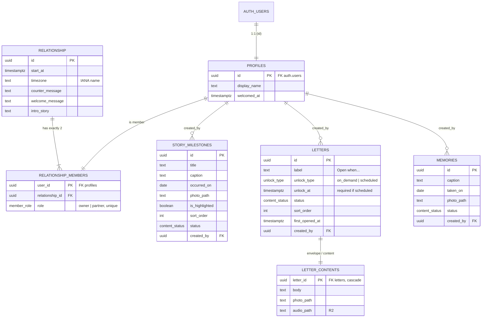

# Database Design — Our Little Universe

| Field | Value |
|---|---|
| Status | **APPROVED by owner (DESIGN)** |
| Version | 0.1 |
| Engine | Supabase Postgres (free tier) |

The database is the security boundary. Everything the partner can or cannot
see is decided here, not in React.

---

## 1. ERD (R1)



All tables also have `created_at timestamptz default now()` and
`updated_at timestamptz` maintained by a shared trigger.

R1 stretch: `love_reasons (id, number unique, body, category, status, created_by)`.

### Relationship reasoning

| Relationship | Why |
|---|---|
| `profiles` 1:1 `auth.users` | Supabase pattern: app data separate from the auth schema; cascade delete on user removal |
| `relationship` singleton | Exactly one couple (TD-007). Enforced by a unique index on a constant, so a second row is impossible |
| `relationship_members` with `unique(role)` | Guarantees at most one owner and one partner, so "only two accounts" is a database fact, not a convention |
| No `relationship_id` on content tables | With one relationship, it adds a column and a join to every policy for no benefit (YAGNI). Membership is checked via `is_member()` |
| `letters` 1:1 `letter_contents` | RLS filters rows, not columns. Splitting the body into its own table, with **no partner SELECT policy at all**, makes leaking a locked body structurally impossible through the table API |
| `created_by` on content | Drives "edit/delete own memory" and "added by" |

## 2. Types

```
member_role    = enum('owner', 'partner')
content_status = enum('draft', 'published')
unlock_type    = enum('on_demand', 'scheduled')
```

## 3. Tables & constraints

| Table | Key constraints | Indexes | Delete behaviour |
|---|---|---|---|
| `profiles` | `id` PK → `auth.users(id)` | — | cascade from auth.users |
| `relationship` | `timezone` validated by trigger (must be a valid IANA zone); `start_at` not null | unique singleton index | never deleted |
| `relationship_members` | PK `user_id` → profiles; `relationship_id` → relationship; `unique(relationship_id, role)` | — | cascade from profiles |
| `story_milestones` | `title` 1–120 chars; `caption` ≤ 2000 | `(status, occurred_on, sort_order)` | photo file removed by app (§7) |
| `letters` | `label` 1–80; `check ((unlock_type = 'scheduled') = (unlock_at is not null))` | `(status, unlock_at)` | cascades to `letter_contents` |
| `letter_contents` | PK/FK `letter_id` → letters **on delete cascade**; `body` 1–20,000 | — | cascade |
| `memories` | `photo_path` not null and must start with `memories/<id>/`; `caption` ≤ 500 | `(status, taken_on desc)`, `(created_by)` | photo file removed by app (§7) |

## 4. Helper functions

All `SECURITY DEFINER`, `set search_path = ''`, `stable`. They read
`relationship_members` with definer rights (avoids recursive RLS) and are
executable only by `authenticated`.

| Function | Returns |
|---|---|
| `is_member()` | true if `auth.uid()` is in `relationship_members` |
| `is_owner()` | true if `auth.uid()` has role `owner` |
| `letter_is_open(letter_id uuid)` | true if published **and** (`on_demand` **or** `unlock_at <= now()`) |

## 5. Row Level Security

RLS **enabled on every table**; no policies for `anon`; all policies target
`authenticated`. Default = deny.

| Table | SELECT | INSERT | UPDATE | DELETE |
|---|---|---|---|---|
| `profiles` | `is_member()` | — (provisioning) | own row or `is_owner()` (display_name only, via column grants) | — |
| `relationship` | `is_member()` | — (provisioning) | `is_owner()` | — |
| `relationship_members` | `is_member()` | — | — | — |
| `story_milestones` | `is_owner()` or (`is_member()` and `status='published'`) | `is_owner()` | `is_owner()` | `is_owner()` |
| `letters` | `is_owner()` or (`is_member()` and `status='published'`) | `is_owner()` | `is_owner()` | `is_owner()` |
| `letter_contents` | **`is_owner()` only** | `is_owner()` | `is_owner()` | `is_owner()` |
| `memories` | `is_owner()` or (`is_member()` and `status='published'`) | `is_member()` and `created_by = auth.uid()` and (`is_owner()` or `status='published'`) | (`is_owner()` or `created_by = auth.uid()`); check keeps `created_by` unchanged | `is_owner()` or `created_by = auth.uid()` |
| `love_reasons` (stretch) | `is_owner()` or published | owner | owner | owner |

Note: the partner can see a published envelope (label, unlock time, opened
state) but **never** the `letter_contents` row via the table API. She
reads content only through `open_letter()`.

## 6. Database functions (the "API")

There is no custom server. The client uses the Supabase table API (PostgREST)
under RLS, plus these RPCs:

| RPC | Security | Who | Behaviour |
|---|---|---|---|
| `open_letter(p_letter_id uuid)` → `{label, body, photo_path, audio_path, first_opened_at}` | DEFINER | members | Raises `not_found` unless the caller is a member and (owner or `letter_is_open`). If the caller is the partner and `first_opened_at` is null, sets it to `now()`. Never returns content for locked/draft letters. |
| `mark_welcomed()` → void | DEFINER | members | Sets the caller's `profiles.welcomed_at` if null |
| `get_server_time()` → timestamptz | INVOKER | members | `now()`, for countdown calibration (display only) |
| `keepalive()` → int | INVOKER | `anon` | Returns 1. Touches no personal data. Used by the scheduled keep-alive job |
| `revoke_partner_sessions()` → int | DEFINER | **service_role only** | Deletes the partner's rows in `auth.sessions` (used by key rotation) |

### Table API usage (client)

| Operation | Call |
|---|---|
| Settings | `relationship` select (single) / update |
| Profiles | `profiles` select; owner updates names |
| Milestones | `story_milestones` select ordered by `occurred_on, sort_order`; CRUD (owner) |
| Envelopes | `letters` select ordered (envelope fields only) |
| Letter content (owner editor) | `letter_contents` select/upsert (owner) |
| Memories | `memories` select paged (24) by `taken_on desc`; insert/update/delete |

Errors are surfaced as typed results in `features/*/api.ts` (no raw errors to the UI).

## 7. Storage

- **One private bucket** `media` (not public). Max object size 5 MB (after client compression files are ~0.3–0.5 MB; the cap rejects uncompressed uploads). Allowed MIME: `image/webp`, `image/jpeg`, `image/png` (R2 adds audio).
- **Path convention:** `{module}/{row_id}/{random}.{ext}`, e.g. `memories/7c1…/a91….webp`. The row id in the path lets policies join to the owning row.

| Path prefix | SELECT (create signed URL) | INSERT | DELETE |
|---|---|---|---|
| `story/<id>/…` | owner, or member and milestone published | owner | owner |
| `letters/<id>/…` | owner, or member and `letter_is_open(id)` | owner | owner |
| `memories/<id>/…` | owner, or member and memory published | member (her uploads are tracked by `owner_id = auth.uid()`) | owner, or `owner_id = auth.uid()` |

Policies compare the folder segment as text (`l.id::text = (storage.foldername(name))[2]`) to avoid cast errors.

**Order of operations** (no cross-service transactions exist, so the app keeps them consistent):
- Create: upload file → insert row. If the insert fails → delete the file.
- Replace: upload new file → update row → delete old file.
- Delete: delete row → delete file. (A failed file delete leaves an orphan; an R2 cleanup query lists objects without rows.)

Signed URLs: 60-minute lifetime, cached client-side ~55 minutes.

## 8. Migrations

Plain SQL in `supabase/migrations/`, applied in order to `dev` then `prod`.
Never edited after being applied; changes = new migration.

| File | Contents |
|---|---|
| `0001_foundation.sql` | enums, `set_updated_at()` trigger fn, timezone validator |
| `0002_core.sql` | `profiles`, `relationship`, `relationship_members` + constraints |
| `0003_content.sql` | `story_milestones`, `letters`, `letter_contents`, `memories` |
| `0004_security_helpers.sql` | `is_member`, `is_owner`, `letter_is_open` |
| `0005_rls.sql` | enable RLS + all table policies + column grants |
| `0006_rpc.sql` | `open_letter`, `mark_welcomed`, `get_server_time`, `keepalive`, `revoke_partner_sessions` |
| `0007_storage.sql` | `media` bucket + storage policies |
| `0008_love_reasons.sql` | stretch only |

**Provisioning (once per environment, not in git):** a documented SQL
snippet, run in the Supabase SQL editor, inserts the relationship row and the
two `relationship_members` rows after the two auth users are created. Real
values are typed there by the owner, never committed.

## 9. Security tests (VALIDATE will execute)

Integration tests run against the `dev` project with three test accounts:
`owner`, `partner`, and `stranger` (an authenticated non-member).

| # | Test | Expected |
|---|---|---|
| S1 | anon selects any table | 0 rows / permission denied |
| S2 | stranger selects any table | 0 rows |
| S3 | partner selects `letter_contents` | 0 rows (always) |
| S4 | partner `open_letter` on future scheduled letter | error, no content |
| S5 | partner `open_letter` on draft letter | error |
| S6 | partner `open_letter` on due letter | content returned, `first_opened_at` set |
| S7 | partner creates signed URL for locked letter photo | denied |
| S8 | partner updates/deletes owner's memory | denied |
| S9 | partner inserts memory with `created_by` = owner | denied |
| S10 | partner inserts draft memory | denied |
| S11 | partner updates `letters`/`relationship` | denied |
| S12 | partner sees draft milestones | 0 rows |
| S13 | anyone inserts a 3rd member | denied |
| S14 | owner full CRUD | succeeds |
