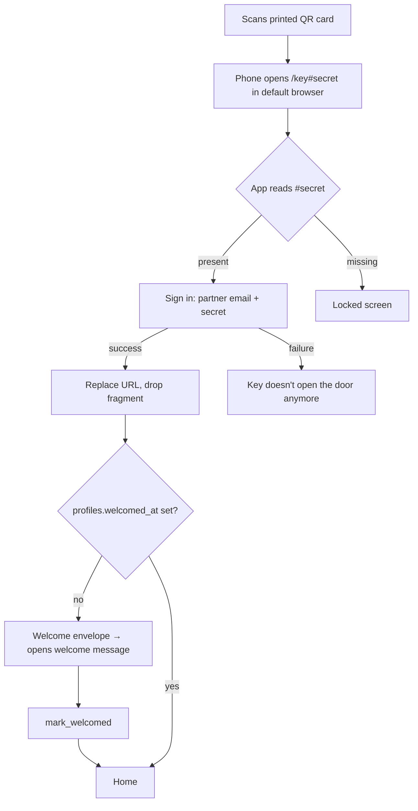
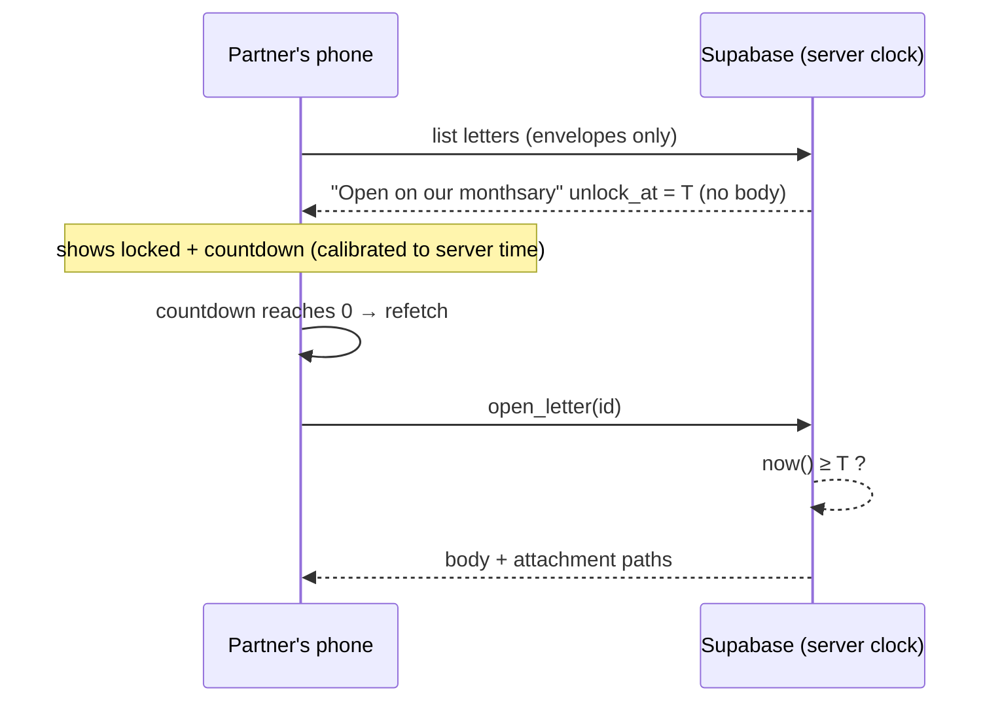

# User Flows — Our Little Universe

| Field | Value |
|---|---|
| Status | **DRAFT — awaiting owner approval (DESIGN)** |
| Version | 0.1 |

Each flow lists steps, the system behaviour behind them, and failure paths.

---

## F1. First entry by QR key (partner, launch moment)

- The fragment never reaches a server (not sent in HTTP requests).
- The session persists on that browser; later visits go straight to Home.
- Failure copy never mentions names.

## F2. Returning visit (either user)

1. Opens site (bookmark, home-screen icon, or rescan).
2. Valid session → Home renders; counter shows immediately from cache, then refreshes.
3. Expired/revoked session → Locked screen (partner) / owner can go to `/owner`.

## F3. Owner sign-in

`/owner` → email + password → Home with owner tools.
Forgot password → reset email → set new password → Home.

## F4. Open an on-demand letter (partner)

1. Letters → taps "Open when you miss me" (state `sealed`).
2. Envelope lifts; "Tap the seal to open".
3. Taps seal → app calls `open_letter(letter_id)`.
4. Database checks: member? published? on_demand or `unlock_at ≤ now()`? → returns body + attachments, records `first_opened_at` if partner and not yet set.
5. Ceremony animation → reading view. Photo loads via signed URL.
6. Close → envelope now `opened ✓`.

Failure paths: network error → envelope reseals, toast "Couldn't open it. Try again?"; content refused (e.g. owner just unpublished) → "This letter isn't ready yet."

## F5. A scheduled letter unlocks (monthsary)

- Before T, the body does not exist in any response the partner receives.
- If her phone clock is wrong, only the countdown display is off; the server clock decides.

## F6. Add a memory (either user)

1. Memories → `[ + ]` → sheet.
2. Choose photo (Android picker). App validates type and size and shows the polaroid preview.
3. Enter caption, date (defaults to today).
4. Save → app compresses the image (≤ 2048 px, WebP/JPEG ≤ ~500 KB) → generates memory id → uploads to `media/memories/<id>/<file>` → inserts `memories` row.
5. Success → sheet closes, new polaroid appears at top, toast "Memory saved".

Failure paths: unsupported format → "This photo type isn't supported. Try a JPG or PNG."; upload fails → retry button, nothing saved; row insert fails after upload → app deletes the uploaded file, shows error.

## F7. Edit / delete a memory

- Edit (own, or owner): change caption/date/replace photo (new file uploaded first, old file deleted after the row update succeeds).
- Delete: confirm dialog "Remove this memory? This can't be undone." → delete storage file → delete row → toast.

## F8. Owner creates a letter

1. Letters → `[ + ]` → editor sheet.
2. Fields: label ("Open when…"), body, optional photo, unlock type (Anytime / On a date), date+time (defaults to the next monthsary at the anchor minute), status (Draft / Published).
3. Save as draft → visible only to owner (dashed "Draft" envelope).
4. Preview as partner → confirms it appears locked/sealed as intended.
5. Publish → partner sees the envelope (but not the body until unlocked).

## F9. Owner adds a story milestone

Story → `[ + ]` → title, date, caption, optional photo, highlight toggle, status → Save. Appears in chronological position.

## F10. Owner edits settings

Settings → change start/timezone/names/words → live preview of next monthsary → Save → counter and default unlock dates update everywhere.
Changing the start moment shows a confirm: "This changes every monthsary and the counter."

## F11. Monthsary day experience (partner)

1. Opens site on the monthsary (after the anchor minute).
2. Home shows "Happy Nth monthsary"; hearts float once (remembered per device per monthsary).
3. "Waiting for you" pins the monthsary letter → F4 sealed flow.

## F12. Owner rotates the partner key (R1 procedure)

1. Owner runs the local key script → generates new secret, sets it as the partner's password, revokes her sessions, writes the QR image into the gitignored `/private` folder.
2. Prints/sends the new QR. Old card now shows "Key doesn't open the door anymore".

## F13. Sign out

More → Sign out → confirm (partner: "You'll need your key card to come back in.") → Locked screen.
